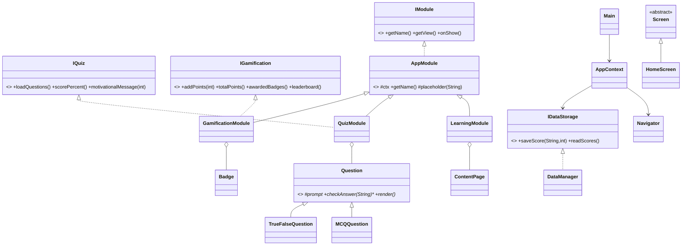

# EduSDG Scaffold Implementation Plan

> **For agentic workers:** REQUIRED SUB-SKILL: Use superpowers:subagent-driven-development (recommended) or superpowers:executing-plans to implement this plan task-by-task. Steps use checkbox (`- [ ]`) syntax for tracking.

**Goal:** Produce a complete set of `(suggestion)`-suffixed reference files for the TMF2954 SDG 4 "Quality Education" Java Swing desktop app, placed beside members' own work without overwriting it, so each member can merge the parts they want.

**Architecture:** Modular OOP. Shared glue (`app/`, `main/`) is fully implemented; each member-owned class/interface ships as a compile-ready skeleton — full structure (packages, imports, declarations, constructors, signatures, `@Override`, overloaded methods, inheritance/abstract wiring) with each graded business-logic body left as `// TODO(Member N)` plus a minimal compilable return. Scores persist to a text file behind a DB-ready `IDataStorage`.

**Tech Stack:** Java 11+ syntax (JDK 25 installed), Java Swing, plain text resource files, no external libraries.

---

## Conventions for this plan

1. **Every created file's name carries ` (suggestion)` before the extension** (e.g. `LearningModule (suggestion).java`). The class/interface name **inside** is the correct final name.
2. **Every generated `.java` file starts with this header comment** (adjust the name + owner):
   ```
   // SUGGESTION (AI-generated reference). Rename to <Name>.java and merge into your own work.
   // Do not overwrite code you have already written.  Owner: Member <N>
   ```
3. **`// TODO(Member N)` markers are intentional deliverable content**, not plan placeholders. They are the parts each member implements.
4. **TDD adaptation:** because graded logic bodies are intentionally left as TODO for the team, our session cannot drive logic to green. Instead we (a) ship a member-facing test file (`tests/ManualTests (suggestion).java`) that is RED now and turns GREEN once members implement — a TDD target handed to the team, and (b) run a **scratch compile** in the final Verification task to prove the set compiles once suffixes are stripped. Visual launch + screenshots are the team's step on their desktops (and are required for submission anyway).
5. **Paths** are relative to the repo root `Java-Project/`. On Windows the working dir already is the repo root.
6. **Commit after each task.** Branch is `feat/edusdg-scaffold` (already created).

---

## File Structure

| Path (with suffix) | Tier | Responsibility |
|---|---|---|
| `.gitignore` | infra | Exclude AI traces, secrets, build output, `data/` |
| `src/interfaces/IModule (suggestion).java` | M1 | Module contract |
| `src/interfaces/IQuiz (suggestion).java` | M2 | Quiz contract |
| `src/interfaces/IGamification (suggestion).java` | M3 | Gamification contract |
| `src/interfaces/IDataStorage (suggestion).java` | M4 | Storage contract |
| `src/app/Theme (suggestion).java` | glue | Colors, fonts, phone dimensions |
| `src/app/Screen (suggestion).java` | glue | Abstract JPanel base |
| `src/app/AppModule (suggestion).java` | glue | Abstract base implementing IModule |
| `src/app/Navigator (suggestion).java` | glue | CardLayout screen switching |
| `src/app/AppContext (suggestion).java` | glue | Shared services wiring |
| `src/app/HomeScreen (suggestion).java` | glue | Main menu |
| `src/main/Main (suggestion).java` | glue | Entry point |
| `src/data/exceptions/DataNotFoundException (suggestion).java` | M4 | Custom exception |
| `src/data/exceptions/InvalidScoreException (suggestion).java` | M4 | Custom exception |
| `src/data/exceptions/ContentLoadException (suggestion).java` | M4 | Custom exception |
| `src/data/UserProfile (suggestion).java` | M4 | User/session model |
| `src/data/DataManager (suggestion).java` | M4 | File-based score storage |
| `src/quiz/Question (suggestion).java` | M2 | Abstract question |
| `src/quiz/MCQQuestion (suggestion).java` | M2 | MCQ subtype |
| `src/quiz/TrueFalseQuestion (suggestion).java` | M2 | True/False subtype |
| `src/quiz/QuizModule (suggestion).java` | M2 | Quiz flow + scoring |
| `src/learning/ContentPage (suggestion).java` | M1 | One learning screen model |
| `src/learning/LearningModule (suggestion).java` | M1 | Learning screen flow |
| `src/gamification/Badge (suggestion).java` | M3 | Badge model |
| `src/gamification/GamificationModule (suggestion).java` | M3 | Points/badges/leaderboard |
| `resources/quiz/questions (suggestion).txt` | content | ≥20 questions |
| `resources/learning/content (suggestion).txt` | content | ≥10 screens |
| `tests/ManualTests (suggestion).java` | test | Member TDD target |
| `build (suggestion).bat` / `run (suggestion).bat` | infra | Command-line build/run |
| `README (suggestion).md` | docs | Updated readme (real README.md untouched) |
| `docs/uml (suggestion).puml` / `docs/uml (suggestion).md` | docs | Class diagram |

---

## Task 1: `.gitignore`

**Files:**
- Create: `.gitignore`

- [ ] **Step 1: Create `.gitignore` with this content**

```gitignore
# --- AI usage traces (do not share) ---
.claude/
docs/superpowers/
CLAUDE.md
AGENTS.md
memory/
*.ai.md

# --- Sensitive info ---
.env
*.env
*.key
*.pem
secrets*
credentials*

# --- Build & runtime output ---
out/
*.class
data/
derby.log
*.log

# --- IDE / OS ---
.idea/
.vscode/
nbproject/private/
*.iml
.DS_Store
Thumbs.db
```

- [ ] **Step 2: Commit**

```bash
git add .gitignore
git commit -m "chore: add .gitignore for AI traces, secrets, and build output"
```

---

## Task 2: Interfaces (Member-owned contracts)

**Files:**
- Create: `src/interfaces/IModule (suggestion).java`
- Create: `src/interfaces/IQuiz (suggestion).java`
- Create: `src/interfaces/IGamification (suggestion).java`
- Create: `src/interfaces/IDataStorage (suggestion).java`

- [ ] **Step 1: Create `src/interfaces/IModule (suggestion).java`**

```java
// SUGGESTION (AI-generated reference). Rename to IModule.java and merge into your own work.
// Do not overwrite code you have already written.  Owner: Member 1
package interfaces;

import javax.swing.JComponent;

/** Contract every app module (Learning, Quiz, Gamification) implements. */
public interface IModule {
    String getName();
    JComponent getView();
    void onShow();
}
```

- [ ] **Step 2: Create `src/interfaces/IQuiz (suggestion).java`**

```java
// SUGGESTION (AI-generated reference). Rename to IQuiz.java and merge into your own work.
// Do not overwrite code you have already written.  Owner: Member 2
package interfaces;

import java.util.List;
import quiz.Question;

/** Contract for the quiz logic. */
public interface IQuiz {
    List<Question> loadQuestions();
    int scorePercent();
    String motivationalMessage(int percent);
}
```

- [ ] **Step 3: Create `src/interfaces/IGamification (suggestion).java`**

```java
// SUGGESTION (AI-generated reference). Rename to IGamification.java and merge into your own work.
// Do not overwrite code you have already written.  Owner: Member 3
package interfaces;

import java.util.List;
import gamification.Badge;

/** Contract for points, badges, and leaderboard. */
public interface IGamification {
    void addPoints(int points);
    int totalPoints();
    List<Badge> awardedBadges();
    List<String> leaderboard();
}
```

- [ ] **Step 4: Create `src/interfaces/IDataStorage (suggestion).java`**

```java
// SUGGESTION (AI-generated reference). Rename to IDataStorage.java and merge into your own work.
// Do not overwrite code you have already written.  Owner: Member 4
package interfaces;

import java.util.List;
import data.exceptions.InvalidScoreException;
import data.exceptions.DataNotFoundException;

/** Storage contract. Implemented now by a text-file DataManager; swappable for a DB later. */
public interface IDataStorage {
    void saveScore(String user, int score) throws InvalidScoreException;
    List<String[]> readScores() throws DataNotFoundException;
}
```

- [ ] **Step 5: Commit**

```bash
git add "src/interfaces/"
git commit -m "feat: add suggestion files for the four module interfaces"
```

---

## Task 3: Shared glue — Theme + Screen

**Files:**
- Create: `src/app/Theme (suggestion).java`
- Create: `src/app/Screen (suggestion).java`

- [ ] **Step 1: Create `src/app/Theme (suggestion).java`**

```java
// SUGGESTION (AI-generated reference). Rename to Theme.java and merge into your own work.
// Do not overwrite code you have already written.  Owner: Member 1 (shared glue)
package app;

import java.awt.Color;
import java.awt.Font;

/** Shared look-and-feel constants. Phone-sized window. SDG 4 accent colour is red (#C5192D). */
public final class Theme {
    private Theme() {}
    public static final int APP_WIDTH = 360;
    public static final int APP_HEIGHT = 720;
    public static final Color PRIMARY = new Color(0xC5192D);
    public static final Color BG = Color.WHITE;
    public static final Color TEXT = new Color(0x222222);
    public static final Font TITLE_FONT = new Font("SansSerif", Font.BOLD, 18);
    public static final Font BODY_FONT = new Font("SansSerif", Font.PLAIN, 14);
}
```

- [ ] **Step 2: Create `src/app/Screen (suggestion).java`**

```java
// SUGGESTION (AI-generated reference). Rename to Screen.java and merge into your own work.
// Do not overwrite code you have already written.  Owner: Member 1 (shared glue)
package app;

import javax.swing.*;
import java.awt.*;

/** Abstract base for every full-screen panel. Provides a coloured title header. */
public abstract class Screen extends JPanel {
    protected final AppContext ctx;

    protected Screen(AppContext ctx, String title) {
        this.ctx = ctx;
        setLayout(new BorderLayout());
        setBackground(Theme.BG);
        setPreferredSize(new Dimension(Theme.APP_WIDTH, Theme.APP_HEIGHT));
        add(buildHeader(title), BorderLayout.NORTH);
    }

    private JComponent buildHeader(String title) {
        JLabel h = new JLabel(title, SwingConstants.CENTER);
        h.setOpaque(true);
        h.setBackground(Theme.PRIMARY);
        h.setForeground(Color.WHITE);
        h.setFont(Theme.TITLE_FONT);
        h.setBorder(BorderFactory.createEmptyBorder(12, 8, 12, 8));
        return h;
    }
}
```

- [ ] **Step 3: Commit**

```bash
git add "src/app/Theme (suggestion).java" "src/app/Screen (suggestion).java"
git commit -m "feat: add Theme and Screen base suggestion files"
```

---

## Task 4: Shared glue — AppModule, Navigator, AppContext

**Files:**
- Create: `src/app/AppModule (suggestion).java`
- Create: `src/app/Navigator (suggestion).java`
- Create: `src/app/AppContext (suggestion).java`

- [ ] **Step 1: Create `src/app/AppModule (suggestion).java`**

```java
// SUGGESTION (AI-generated reference). Rename to AppModule.java and merge into your own work.
// Do not overwrite code you have already written.  Owner: Member 1 (shared glue)
package app;

import interfaces.IModule;
import javax.swing.*;
import java.awt.*;

/** Abstract base every module extends. Demonstrates abstraction + inheritance. */
public abstract class AppModule implements IModule {
    protected final AppContext ctx;
    private final String name;

    protected AppModule(AppContext ctx, String name) {
        this.ctx = ctx;
        this.name = name;
    }

    @Override public String getName() { return name; }
    @Override public void onShow() { /* override to refresh when navigated to */ }

    /** Compile-ready placeholder shown until a member fills in getView(). */
    protected JComponent placeholder(String todo) {
        JPanel p = new JPanel(new BorderLayout());
        p.setBackground(Theme.BG);
        JLabel l = new JLabel(
            "<html><center><b>" + name + "</b><br>TODO: " + todo + "</center></html>",
            SwingConstants.CENTER);
        l.setFont(Theme.BODY_FONT);
        p.add(l, BorderLayout.CENTER);
        return p;
    }
}
```

- [ ] **Step 2: Create `src/app/Navigator (suggestion).java`**

```java
// SUGGESTION (AI-generated reference). Rename to Navigator.java and merge into your own work.
// Do not overwrite code you have already written.  Owner: Member 1 (shared glue)
package app;

import interfaces.IModule;
import javax.swing.*;
import java.awt.*;
import java.util.HashMap;
import java.util.Map;

/** CardLayout-based screen switching. Holds modules polymorphically as IModule. */
public class Navigator {
    private final JPanel container = new JPanel(new CardLayout());
    private final Map<String, IModule> modules = new HashMap<>();

    public void registerScreen(String name, JComponent view) {
        container.add(view, name);
    }

    public void registerModule(IModule module) {     // polymorphism: any IModule
        modules.put(module.getName(), module);
        container.add(module.getView(), module.getName());
    }

    public void show(String name) {
        IModule m = modules.get(name);
        if (m != null) m.onShow();
        ((CardLayout) container.getLayout()).show(container, name);
    }

    public JComponent getContainer() { return container; }
}
```

- [ ] **Step 3: Create `src/app/AppContext (suggestion).java`**

```java
// SUGGESTION (AI-generated reference). Rename to AppContext.java and merge into your own work.
// Do not overwrite code you have already written.  Owner: Member 1 (shared glue)
package app;

import interfaces.IDataStorage;
import data.DataManager;

/** Holds shared services so modules don't construct their own. DB-swap point is here. */
public class AppContext {
    private final Navigator navigator = new Navigator();
    private final IDataStorage storage = new DataManager("data/scores.txt");

    public Navigator navigator() { return navigator; }
    public IDataStorage storage() { return storage; }
}
```

- [ ] **Step 4: Commit**

```bash
git add "src/app/AppModule (suggestion).java" "src/app/Navigator (suggestion).java" "src/app/AppContext (suggestion).java"
git commit -m "feat: add AppModule, Navigator, AppContext suggestion files"
```

---

## Task 5: Shared glue — HomeScreen + Main

**Files:**
- Create: `src/app/HomeScreen (suggestion).java`
- Create: `src/main/Main (suggestion).java`

- [ ] **Step 1: Create `src/app/HomeScreen (suggestion).java`**

```java
// SUGGESTION (AI-generated reference). Rename to HomeScreen.java and merge into your own work.
// Do not overwrite code you have already written.  Owner: Member 1 (shared glue)
package app;

import javax.swing.*;
import java.awt.*;

/** Main menu with buttons to each module. */
public class HomeScreen extends Screen {
    public HomeScreen(AppContext ctx) {
        super(ctx, "EduSDG - SDG 4 Quality Education");
        JPanel menu = new JPanel(new GridLayout(0, 1, 10, 10));
        menu.setBackground(Theme.BG);
        menu.setBorder(BorderFactory.createEmptyBorder(40, 30, 40, 30));
        menu.add(navButton("Learn", "Learning"));
        menu.add(navButton("Take Quiz", "Quiz"));
        menu.add(navButton("Achievements", "Gamification"));
        add(menu, BorderLayout.CENTER);
    }

    private JButton navButton(String label, String target) {
        JButton b = new JButton(label);
        b.setFont(Theme.BODY_FONT);
        b.addActionListener(e -> ctx.navigator().show(target));
        return b;
    }
}
```

- [ ] **Step 2: Create `src/main/Main (suggestion).java`**

```java
// SUGGESTION (AI-generated reference). Rename to Main.java and merge into your own work.
// Do not overwrite code you have already written.  Owner: Member 1 (shared glue)
package main;

import app.AppContext;
import app.HomeScreen;
import app.Theme;
import learning.LearningModule;
import quiz.QuizModule;
import gamification.GamificationModule;
import javax.swing.*;

/** Application entry point. Build & run from the command line (see build.bat / run.bat). */
public class Main {
    public static void main(String[] args) {
        SwingUtilities.invokeLater(Main::start);
    }

    private static void start() {
        AppContext ctx = new AppContext();
        ctx.navigator().registerScreen("home", new HomeScreen(ctx));
        ctx.navigator().registerModule(new LearningModule(ctx));
        ctx.navigator().registerModule(new QuizModule(ctx));
        ctx.navigator().registerModule(new GamificationModule(ctx));

        JFrame frame = new JFrame("EduSDG - SDG 4 Quality Education");
        frame.setDefaultCloseOperation(JFrame.EXIT_ON_CLOSE);
        frame.setContentPane(ctx.navigator().getContainer());
        frame.setResizable(false);
        frame.pack();
        frame.setSize(Theme.APP_WIDTH, Theme.APP_HEIGHT);
        frame.setLocationRelativeTo(null);
        ctx.navigator().show("home");
        frame.setVisible(true);
    }
}
```

- [ ] **Step 3: Commit**

```bash
git add "src/app/HomeScreen (suggestion).java" "src/main/Main (suggestion).java"
git commit -m "feat: add HomeScreen and Main entry-point suggestion files"
```

---

## Task 6: Data module (Member 4) — exceptions, UserProfile, DataManager

**Files:**
- Create: `src/data/exceptions/DataNotFoundException (suggestion).java`
- Create: `src/data/exceptions/InvalidScoreException (suggestion).java`
- Create: `src/data/exceptions/ContentLoadException (suggestion).java`
- Create: `src/data/UserProfile (suggestion).java`
- Create: `src/data/DataManager (suggestion).java`

- [ ] **Step 1: Create `src/data/exceptions/DataNotFoundException (suggestion).java`**

```java
// SUGGESTION (AI-generated reference). Rename to DataNotFoundException.java and merge into your own work.
// Do not overwrite code you have already written.  Owner: Member 4
package data.exceptions;

/** Thrown when stored data cannot be located or read. */
public class DataNotFoundException extends Exception {
    public DataNotFoundException(String message) { super(message); }
    public DataNotFoundException(String message, Throwable cause) { super(message, cause); }
}
```

- [ ] **Step 2: Create `src/data/exceptions/InvalidScoreException (suggestion).java`**

```java
// SUGGESTION (AI-generated reference). Rename to InvalidScoreException.java and merge into your own work.
// Do not overwrite code you have already written.  Owner: Member 4
package data.exceptions;

/** Thrown when a score is outside the valid 0..100 range. */
public class InvalidScoreException extends Exception {
    public InvalidScoreException(String message) { super(message); }
}
```

- [ ] **Step 3: Create `src/data/exceptions/ContentLoadException (suggestion).java`**

```java
// SUGGESTION (AI-generated reference). Rename to ContentLoadException.java and merge into your own work.
// Do not overwrite code you have already written.  Owner: Member 4
package data.exceptions;

/** Thrown when a resource file (quiz/learning content) cannot be loaded. */
public class ContentLoadException extends Exception {
    public ContentLoadException(String message, Throwable cause) { super(message, cause); }
}
```

- [ ] **Step 4: Create `src/data/UserProfile (suggestion).java`**

```java
// SUGGESTION (AI-generated reference). Rename to UserProfile.java and merge into your own work.
// Do not overwrite code you have already written.  Owner: Member 4
package data;

/** Simple per-session user model. */
public class UserProfile {
    private final String name;
    private int lastScore;

    public UserProfile(String name) { this.name = name; }

    public String getName() { return name; }
    public int getLastScore() { return lastScore; }
    public void setLastScore(int lastScore) { this.lastScore = lastScore; }
}
```

- [ ] **Step 5: Create `src/data/DataManager (suggestion).java`**

```java
// SUGGESTION (AI-generated reference). Rename to DataManager.java and merge into your own work.
// Do not overwrite code you have already written.  Owner: Member 4
package data;

import interfaces.IDataStorage;
import data.exceptions.InvalidScoreException;
import data.exceptions.DataNotFoundException;
import java.util.ArrayList;
import java.util.List;

/**
 * Text-file score storage. No hardcoding: scores are read/written to scores.txt.
 * Demonstrates method overloading (two saveScore signatures) and custom exceptions.
 * Line format: name,score,timestamp
 */
public class DataManager implements IDataStorage {
    private final String filePath;

    public DataManager(String filePath) { this.filePath = filePath; }

    @Override
    public void saveScore(String user, int score) throws InvalidScoreException {
        // TODO(Member 4): if score < 0 || score > 100 throw new InvalidScoreException(...).
        //   Otherwise append "user,score," + System.currentTimeMillis() as a new line to
        //   filePath using try-with-resources (new FileWriter(filePath, true) wrapped in
        //   BufferedWriter). Create the data/ folder if missing.
    }

    /** Overloaded convenience: save straight from a UserProfile. */
    public void saveScore(UserProfile profile) throws InvalidScoreException {
        // TODO(Member 4): delegate -> saveScore(profile.getName(), profile.getLastScore()).
    }

    @Override
    public List<String[]> readScores() throws DataNotFoundException {
        // TODO(Member 4): read every line of filePath, split on ",", add as String[] to a list.
        //   Return an empty list if the file does not exist yet.
        //   Wrap any IOException in a new DataNotFoundException(message, cause).
        return new ArrayList<>();
    }
}
```

- [ ] **Step 6: Commit**

```bash
git add "src/data/"
git commit -m "feat: add data module suggestion files (exceptions, UserProfile, DataManager)"
```

---

## Task 7: Quiz module (Member 2) — Question hierarchy + QuizModule

**Files:**
- Create: `src/quiz/Question (suggestion).java`
- Create: `src/quiz/MCQQuestion (suggestion).java`
- Create: `src/quiz/TrueFalseQuestion (suggestion).java`
- Create: `src/quiz/QuizModule (suggestion).java`

- [ ] **Step 1: Create `src/quiz/Question (suggestion).java`**

```java
// SUGGESTION (AI-generated reference). Rename to Question.java and merge into your own work.
// Do not overwrite code you have already written.  Owner: Member 2
package quiz;

import javax.swing.JComponent;

/** Abstract question. Subclasses override checkAnswer() and render() (polymorphism). */
public abstract class Question {
    protected final String prompt;

    protected Question(String prompt) { this.prompt = prompt; }

    public String getPrompt() { return prompt; }

    public abstract boolean checkAnswer(String response);
    public abstract JComponent render();
}
```

- [ ] **Step 2: Create `src/quiz/MCQQuestion (suggestion).java`**

```java
// SUGGESTION (AI-generated reference). Rename to MCQQuestion.java and merge into your own work.
// Do not overwrite code you have already written.  Owner: Member 2
package quiz;

import javax.swing.*;
import java.util.List;

/** Multiple-choice question. Inherits from Question; overrides checkAnswer + render. */
public class MCQQuestion extends Question {
    private final List<String> options;
    private final int correctIndex;

    public MCQQuestion(String prompt, List<String> options, int correctIndex) {
        super(prompt);
        this.options = options;
        this.correctIndex = correctIndex;
    }

    public List<String> getOptions() { return options; }

    @Override
    public boolean checkAnswer(String response) {
        // TODO(Member 2): return true when response equals options.get(correctIndex).
        //   Trim and compare case-insensitively to be forgiving.
        return false;
    }

    @Override
    public JComponent render() {
        // TODO(Member 2): build a JPanel containing the prompt and a ButtonGroup of
        //   JRadioButtons (one per option) and return it.
        return new JPanel();
    }
}
```

- [ ] **Step 3: Create `src/quiz/TrueFalseQuestion (suggestion).java`**

```java
// SUGGESTION (AI-generated reference). Rename to TrueFalseQuestion.java and merge into your own work.
// Do not overwrite code you have already written.  Owner: Member 2
package quiz;

import javax.swing.*;

/** True/False question. Inherits from Question; overrides checkAnswer + render. */
public class TrueFalseQuestion extends Question {
    private final boolean correct;

    public TrueFalseQuestion(String prompt, boolean correct) {
        super(prompt);
        this.correct = correct;
    }

    @Override
    public boolean checkAnswer(String response) {
        // TODO(Member 2): parse response ("true"/"false", ignore case) and compare with 'correct'.
        return false;
    }

    @Override
    public JComponent render() {
        // TODO(Member 2): build a JPanel with the prompt and True / False buttons; return it.
        return new JPanel();
    }
}
```

- [ ] **Step 4: Create `src/quiz/QuizModule (suggestion).java`**

```java
// SUGGESTION (AI-generated reference). Rename to QuizModule.java and merge into your own work.
// Do not overwrite code you have already written.  Owner: Member 2
package quiz;

import app.AppContext;
import app.AppModule;
import interfaces.IQuiz;
import javax.swing.JComponent;
import java.util.ArrayList;
import java.util.List;

/** Quiz flow: loads questions, presents them, scores, persists, motivates. */
public class QuizModule extends AppModule implements IQuiz {
    private final List<Question> questions = new ArrayList<>();
    private int correctCount = 0;

    public QuizModule(AppContext ctx) { super(ctx, "Quiz"); }

    @Override
    public List<Question> loadQuestions() {
        // TODO(Member 2): read resources/quiz/questions.txt (skip lines starting with '#'),
        //   split each line on '|', build MCQQuestion (TYPE=MCQ; options split on ';';
        //   last field = correct index) or TrueFalseQuestion (TYPE=TF; last field = true/false),
        //   add to 'questions', and return it.
        return questions;
    }

    @Override
    public int scorePercent() {
        // TODO(Member 2): return questions.isEmpty() ? 0 : correctCount * 100 / questions.size().
        return 0;
    }

    @Override
    public String motivationalMessage(int percent) {
        // TODO(Member 2): map percent to the EXACT scale:
        //   80-100 -> "Outstanding!"      60-79 -> "That's good!"
        //   40-59  -> "Good try!"         20-39 -> "You can do better!"
        //   0-19   -> "Don't give up!"
        return "";
    }

    @Override
    public JComponent getView() {
        // TODO(Member 2): build the quiz UI - show one question's render() at a time, advance
        //   on answer, increment correctCount when checkAnswer() is true, then display
        //   scorePercent() + motivationalMessage(scorePercent()) and call
        //   ctx.storage().saveScore("player", scorePercent()) inside try-catch.
        return placeholder("quiz: load 20+ questions, score, motivational message, save");
    }
}
```

- [ ] **Step 5: Commit**

```bash
git add "src/quiz/"
git commit -m "feat: add quiz module suggestion files (Question hierarchy + QuizModule)"
```

---

## Task 8: Learning module (Member 1) — ContentPage + LearningModule

**Files:**
- Create: `src/learning/ContentPage (suggestion).java`
- Create: `src/learning/LearningModule (suggestion).java`

- [ ] **Step 1: Create `src/learning/ContentPage (suggestion).java`**

```java
// SUGGESTION (AI-generated reference). Rename to ContentPage.java and merge into your own work.
// Do not overwrite code you have already written.  Owner: Member 1
package learning;

/** One learning screen. Overloaded constructor leaves room for an image path (unused for now). */
public class ContentPage {
    private final String title;
    private final String body;
    private final String imagePath; // optional; no images for now

    public ContentPage(String title, String body) {
        this(title, body, null);
    }

    public ContentPage(String title, String body, String imagePath) {
        this.title = title;
        this.body = body;
        this.imagePath = imagePath;
    }

    public String getTitle() { return title; }
    public String getBody() { return body; }
    public String getImagePath() { return imagePath; }
}
```

- [ ] **Step 2: Create `src/learning/LearningModule (suggestion).java`**

```java
// SUGGESTION (AI-generated reference). Rename to LearningModule.java and merge into your own work.
// Do not overwrite code you have already written.  Owner: Member 1
package learning;

import app.AppContext;
import app.AppModule;
import javax.swing.JComponent;
import java.util.ArrayList;
import java.util.List;

/** Learning module: cycles through >=10 content screens with Prev/Next. */
public class LearningModule extends AppModule {
    private final List<ContentPage> pages = new ArrayList<>();
    private int index = 0;

    public LearningModule(AppContext ctx) { super(ctx, "Learning"); }

    public List<ContentPage> loadPages() {
        // TODO(Member 1): read resources/learning/content.txt - blocks separated by a line
        //   containing only "---"; first line of a block = title, remaining lines = body.
        //   Build a ContentPage per block, add to 'pages', return it (>=10 expected).
        return pages;
    }

    @Override
    public JComponent getView() {
        // TODO(Member 1): build a panel that shows pages.get(index) (title + body) with
        //   Prev/Next buttons that change 'index' and refresh the displayed text.
        return placeholder("learning: 10+ content screens with Prev/Next");
    }
}
```

- [ ] **Step 3: Commit**

```bash
git add "src/learning/"
git commit -m "feat: add learning module suggestion files (ContentPage + LearningModule)"
```

---

## Task 9: Gamification module (Member 3) — Badge + GamificationModule

**Files:**
- Create: `src/gamification/Badge (suggestion).java`
- Create: `src/gamification/GamificationModule (suggestion).java`

- [ ] **Step 1: Create `src/gamification/Badge (suggestion).java`**

```java
// SUGGESTION (AI-generated reference). Rename to Badge.java and merge into your own work.
// Do not overwrite code you have already written.  Owner: Member 3
package gamification;

/** A reward badge. Overloaded constructors (name only, or name + description). */
public class Badge {
    private final String name;
    private final String description;

    public Badge(String name) { this(name, ""); }

    public Badge(String name, String description) {
        this.name = name;
        this.description = description;
    }

    public String getName() { return name; }
    public String getDescription() { return description; }
}
```

- [ ] **Step 2: Create `src/gamification/GamificationModule (suggestion).java`**

```java
// SUGGESTION (AI-generated reference). Rename to GamificationModule.java and merge into your own work.
// Do not overwrite code you have already written.  Owner: Member 3
package gamification;

import app.AppContext;
import app.AppModule;
import interfaces.IGamification;
import javax.swing.JComponent;
import java.util.ArrayList;
import java.util.List;

/** Points, badges, timer, leaderboard. Overloaded addPoints demonstrates overloading. */
public class GamificationModule extends AppModule implements IGamification {
    private int points = 0;
    private final List<Badge> badges = new ArrayList<>();

    public GamificationModule(AppContext ctx) { super(ctx, "Gamification"); }

    @Override
    public void addPoints(int p) {
        // TODO(Member 3): points += p; award a Badge when points crosses thresholds
        //   (e.g. 50 -> "Rising Star", 100 -> "Scholar") and add it to 'badges'.
    }

    /** Overloaded: add points with a reason to display/log. */
    public void addPoints(int p, String reason) {
        // TODO(Member 3): call addPoints(p) then record/show 'reason'.
    }

    @Override public int totalPoints() { return points; }
    @Override public List<Badge> awardedBadges() { return badges; }

    @Override
    public List<String> leaderboard() {
        // TODO(Member 3): call ctx.storage().readScores() inside try-catch, sort rows by the
        //   integer score descending, format each as "name - score", return the list.
        return new ArrayList<>();
    }

    @Override
    public JComponent getView() {
        // TODO(Member 3): build the achievements screen - total points, badge icons/list,
        //   a quiz timer, and the leaderboard() entries.
        return placeholder("gamification: badges, points, timer, leaderboard");
    }
}
```

- [ ] **Step 3: Commit**

```bash
git add "src/gamification/"
git commit -m "feat: add gamification module suggestion files (Badge + GamificationModule)"
```

---

## Task 10: Content resource files (≥20 quiz questions, ≥10 learning screens)

**Files:**
- Create: `resources/quiz/questions (suggestion).txt`
- Create: `resources/learning/content (suggestion).txt`

- [ ] **Step 1: Create `resources/quiz/questions (suggestion).txt`**

```
# SUGGESTION (AI-generated content). Rename to questions.txt; edit freely.
# Format, one question per line:
#   MCQ|prompt|option1;option2;option3;option4|correctIndex(0-based)
#   TF|prompt||true   (or false)   -- options field is empty for True/False
MCQ|Which Sustainable Development Goal is "Quality Education"?|SDG 1;SDG 3;SDG 4;SDG 5|2
MCQ|What is the main aim of SDG 4?|End poverty;Ensure inclusive and equitable quality education;Clean water for all;Gender equality|1
MCQ|By which year do the SDGs aim to be achieved?|2025;2030;2040;2050|1
MCQ|How many Sustainable Development Goals are there in total?|8;15;17;20|2
MCQ|Which organisation adopted the Sustainable Development Goals in 2015?|WHO;United Nations;UNICEF;World Bank|1
MCQ|SDG 4 promotes lifelong learning opportunities for whom?|Children only;University students only;All;Teachers only|2
MCQ|Which of these is a target of SDG 4?|Free primary and secondary education;More highways;Lower taxes;Faster internet only|0
MCQ|"Inclusive" education means education that:|Excludes some learners;Includes learners of all abilities and backgrounds;Is only online;Costs money|1
MCQ|Which group is especially focused on in SDG 4's equity targets?|Vulnerable and marginalised people;Only adults;Only city residents;Only men|0
MCQ|Quality education contributes most directly to:|Reducing literacy;Empowering people to escape poverty;Increasing pollution;Slowing development|1
MCQ|Which skill does SDG 4 emphasise for sustainable development?|Only sports;Literacy and numeracy;Only memorisation;None|1
MCQ|A key barrier to quality education in many regions is:|Too many teachers;Lack of access and resources;Excess funding;Short holidays|1
MCQ|SDG 4 also calls for safe and inclusive learning:|Salaries;Environments;Holidays;Uniforms|1
MCQ|Teacher training under SDG 4 aims to:|Reduce teacher numbers;Increase the supply of qualified teachers;Replace teachers with robots;End schooling|1
MCQ|Which is a measure of progress toward SDG 4?|Literacy rates;Number of cars;Stock prices;Rainfall|0
TF|SDG 4 stands for Quality Education.||true
TF|The Sustainable Development Goals were adopted in the year 2000.||false
TF|SDG 4 only applies to developed countries.||false
TF|Lifelong learning is part of SDG 4.||true
TF|Gender equality in education is unrelated to SDG 4.||false
TF|There are 17 Sustainable Development Goals.||true
TF|SDG 4 includes a target for free primary and secondary education.||true
```

- [ ] **Step 2: Create `resources/learning/content (suggestion).txt`**

```
# SUGGESTION (AI-generated content). Rename to content.txt; edit freely.
# Each screen is a block: first line = title, following lines = body.
# Separate blocks with a line containing only three dashes:  ---
What is SDG 4?
Sustainable Development Goal 4 is "Quality Education". It aims to ensure inclusive
and equitable quality education and promote lifelong learning opportunities for all.
---
Why Education Matters
Education is a powerful driver of development. It lifts people out of poverty,
improves health, promotes gender equality, and fuels economic growth.
---
The 2030 Agenda
The SDGs were adopted by all United Nations member states in 2015 as part of the
2030 Agenda for Sustainable Development. There are 17 goals in total.
---
Inclusive Education
Inclusive education means every learner - regardless of ability, gender, or
background - has access to learning in a safe and supportive environment.
---
Equitable Access
Equity in education means removing barriers so that vulnerable and marginalised
groups can attend and complete quality schooling.
---
Lifelong Learning
SDG 4 is not just about children. It promotes opportunities to keep learning new
skills throughout life, including technical and vocational training.
---
Literacy and Numeracy
Foundational literacy and numeracy skills are core targets of SDG 4, enabling
people to participate fully in society and the economy.
---
Quality Teachers
A sufficient supply of qualified, well-trained teachers is essential. SDG 4
includes targets to expand teacher training, especially in developing regions.
---
Safe Learning Environments
SDG 4 calls for education facilities that are child-, disability-, and
gender-sensitive, and that provide safe, non-violent, inclusive spaces.
---
Barriers to Education
Poverty, conflict, distance, and lack of resources keep millions of children out
of school. Tackling these barriers is central to achieving SDG 4.
---
Measuring Progress
Progress toward SDG 4 is tracked through indicators such as literacy rates,
school completion rates, and access to trained teachers.
---
What You Can Do
Support quality education by valuing learning, helping others learn, volunteering,
and raising awareness of education as a right for everyone.
```

- [ ] **Step 3: Commit**

```bash
git add "resources/"
git commit -m "content: add SDG 4 quiz bank (22 questions) and 12 learning screens"
```

---

## Task 11: Member-facing test target (TDD handoff)

**Files:**
- Create: `tests/ManualTests (suggestion).java`

- [ ] **Step 1: Create `tests/ManualTests (suggestion).java`**

```java
// SUGGESTION (AI-generated reference). Rename to ManualTests.java and merge into your own work.
// Do not overwrite code you have already written.  Owner: shared (each member checks their part)
// Run after implementing the TODOs:
//   javac -d out src/**/*.java tests/ManualTests.java   (expand globs per build.bat)
//   java -cp out tests.ManualTests
// Prints PASS/FAIL per check. These are RED until the TODO logic is implemented.
package tests;

import quiz.MCQQuestion;
import quiz.QuizModule;
import quiz.TrueFalseQuestion;
import data.DataManager;
import app.AppContext;
import java.util.Arrays;

public class ManualTests {
    private static int pass = 0, fail = 0;

    public static void main(String[] args) {
        // Question.checkAnswer (Member 2)
        MCQQuestion mcq = new MCQQuestion("Q", Arrays.asList("A", "B", "C", "D"), 2);
        check("MCQ correct option", mcq.checkAnswer("C"));
        check("MCQ wrong option", !mcq.checkAnswer("A"));

        TrueFalseQuestion tf = new TrueFalseQuestion("Q", true);
        check("TF correct", tf.checkAnswer("true"));
        check("TF wrong", !tf.checkAnswer("false"));

        // Motivational message scale (Member 2)
        QuizModule qm = new QuizModule(new AppContext());
        check("90% -> Outstanding!", "Outstanding!".equals(qm.motivationalMessage(90)));
        check("65% -> That's good!", "That's good!".equals(qm.motivationalMessage(65)));
        check("45% -> Good try!", "Good try!".equals(qm.motivationalMessage(45)));
        check("25% -> You can do better!", "You can do better!".equals(qm.motivationalMessage(25)));
        check("10% -> Don't give up!", "Don't give up!".equals(qm.motivationalMessage(10)));

        // DataManager round-trip (Member 4)
        try {
            DataManager dm = new DataManager("data/test_scores.txt");
            dm.saveScore("tester", 80);
            check("readScores returns saved row", !dm.readScores().isEmpty());
        } catch (Exception e) {
            check("DataManager round-trip threw: " + e.getMessage(), false);
        }

        System.out.println("\nPASS=" + pass + "  FAIL=" + fail);
    }

    private static void check(String label, boolean condition) {
        System.out.println((condition ? "PASS " : "FAIL ") + label);
        if (condition) pass++; else fail++;
    }
}
```

- [ ] **Step 2: Commit**

```bash
git add "tests/"
git commit -m "test: add member-facing TDD target (ManualTests) for logic checks"
```

---

## Task 12: Build/run scripts + README suggestion

**Files:**
- Create: `build (suggestion).bat`
- Create: `run (suggestion).bat`
- Create: `README (suggestion).md`

- [ ] **Step 1: Create `build (suggestion).bat`**

```bat
@echo off
REM SUGGESTION (AI-generated). Rename to build.bat after merging suggestion files.
REM Compiles all sources to out\
javac -d out ^
  src\main\Main.java ^
  src\app\*.java ^
  src\interfaces\*.java ^
  src\learning\*.java ^
  src\quiz\*.java ^
  src\gamification\*.java ^
  src\data\*.java ^
  src\data\exceptions\*.java
echo Build complete. Run with run.bat
```

- [ ] **Step 2: Create `run (suggestion).bat`**

```bat
@echo off
REM SUGGESTION (AI-generated). Rename to run.bat after merging suggestion files.
java -cp out main.Main
```

- [ ] **Step 3: Create `README (suggestion).md`**

```markdown
# EduSDG - SDG 4 Quality Education Java Application

## Overview
EduSDG is a Java Swing desktop application built around **SDG 4 - Quality Education**.
It has three modules: a Learning Module (12 content screens), a Quiz Module
(22 questions: MCQ + True/False with motivational scoring), and a Gamification
Module (points, badges, timer, leaderboard). Scores are stored in a text file.

## How to Build & Run (command line)
    build.bat        (compiles to out\)
    run.bat          (runs main.Main)
Or manually:
    javac -d out src\main\Main.java src\app\*.java src\interfaces\*.java src\learning\*.java src\quiz\*.java src\gamification\*.java src\data\*.java src\data\exceptions\*.java
    java -cp out main.Main

## Project Structure
    src/main/         Application entry point (Main)
    src/app/          Shared glue: Theme, Screen, AppModule, Navigator, AppContext, HomeScreen
    src/interfaces/   IModule, IQuiz, IGamification, IDataStorage
    src/learning/     LearningModule, ContentPage              (Member 1)
    src/quiz/         QuizModule, Question, MCQQuestion, TrueFalseQuestion (Member 2)
    src/gamification/ GamificationModule, Badge                (Member 3)
    src/data/         DataManager, UserProfile, exceptions/    (Member 4)
    resources/        quiz/questions.txt, learning/content.txt
    data/             scores.txt (created at runtime)

## Team
| Member   | Role                         | Classes                                   | Interface     |
|----------|------------------------------|-------------------------------------------|---------------|
| Member 1 | Core Architecture & Learning | LearningModule, ContentPage               | IModule       |
| Member 2 | Quiz Module                  | QuizModule, Question, MCQQuestion, TrueFalseQuestion | IQuiz |
| Member 3 | Gamification Module          | GamificationModule, Badge                 | IGamification |
| Member 4 | Data & Exception Handling    | DataManager, UserProfile                  | IDataStorage  |

## Score Scale
    80-100% : Outstanding!
    60-79%  : That's good!
    40-59%  : Good try!
    20-39%  : You can do better!
     0-19%  : Don't give up!

## Requirements
- Java 11 or higher (developed/tested on JDK 25)
- No external libraries required
```

- [ ] **Step 4: Commit**

```bash
git add "build (suggestion).bat" "run (suggestion).bat" "README (suggestion).md"
git commit -m "build: add command-line build/run scripts and README suggestion"
```

---

## Task 13: UML diagram for the Project Design PDF

**Files:**
- Create: `docs/uml (suggestion).puml`
- Create: `docs/uml (suggestion).md`

- [ ] **Step 1: Create `docs/uml (suggestion).puml`**

```plantuml
@startuml EduSDG
' SUGGESTION (AI-generated). Render at plantuml.com or with the PlantUML tool.
interface IModule { +getName(): String\n+getView(): JComponent\n+onShow(): void }
interface IQuiz { +loadQuestions(): List<Question>\n+scorePercent(): int\n+motivationalMessage(int): String }
interface IGamification { +addPoints(int): void\n+totalPoints(): int\n+awardedBadges(): List<Badge>\n+leaderboard(): List<String> }
interface IDataStorage { +saveScore(String,int): void\n+readScores(): List<String[]> }

abstract class AppModule { #ctx: AppContext\n+getName(): String\n#placeholder(String): JComponent }
abstract class Question { #prompt: String\n+{abstract}checkAnswer(String): boolean\n+{abstract}render(): JComponent }
abstract class Screen

class LearningModule
class ContentPage
class QuizModule
class MCQQuestion
class TrueFalseQuestion
class GamificationModule
class Badge
class DataManager
class UserProfile
class AppContext
class Navigator
class HomeScreen
class Main

IModule <|.. AppModule
AppModule <|-- LearningModule
AppModule <|-- QuizModule
AppModule <|-- GamificationModule
IQuiz <|.. QuizModule
IGamification <|.. GamificationModule
IDataStorage <|.. DataManager
Question <|-- MCQQuestion
Question <|-- TrueFalseQuestion
Screen <|-- HomeScreen

QuizModule "1" o-- "many" Question
LearningModule "1" o-- "many" ContentPage
GamificationModule "1" o-- "many" Badge
AppContext "1" --> "1" Navigator
AppContext "1" --> "1" IDataStorage
DataManager ..> UserProfile
Main --> AppContext
@enduml
```

- [ ] **Step 2: Create `docs/uml (suggestion).md`**

```markdown
# EduSDG Class Diagram (Mermaid)

SUGGESTION (AI-generated). Renders on GitHub and in many Markdown viewers.


```

- [ ] **Step 3: Commit**

```bash
git add "docs/uml (suggestion).puml" "docs/uml (suggestion).md"
git commit -m "docs: add PlantUML and Mermaid class diagrams for the design PDF"
```

---

## Task 14: Verification — scratch compile of the merged set

**Files:**
- Temporary only (scratch directory `.verify/`, not committed).

- [ ] **Step 1: Copy suggestion files into a scratch tree with proper names**

Run (PowerShell, from repo root):
```powershell
Remove-Item -Recurse -Force .verify -ErrorAction SilentlyContinue
New-Item -ItemType Directory -Force .verify | Out-Null
Get-ChildItem -Recurse -Filter "* (suggestion).*" |
  Where-Object { $_.Extension -in '.java','.txt' } | ForEach-Object {
    $rel = $_.FullName.Substring((Get-Location).Path.Length + 1)
    $dest = Join-Path ".verify" ($rel -replace ' \(suggestion\)', '')
    New-Item -ItemType Directory -Force (Split-Path $dest) | Out-Null
    Copy-Item $_.FullName $dest -Force
  }
```

- [ ] **Step 2: Compile the scratch tree**

Run:
```powershell
javac -d .verify/out (Get-ChildItem -Recurse -Path .verify/src -Filter *.java).FullName
```
Expected: **compiles with no errors** (warnings about unused fields are acceptable).
If it fails, fix the offending suggestion file, re-copy (Step 1), and recompile.

- [ ] **Step 3: Confirm the entry point class is present**

Run:
```powershell
Test-Path .verify/out/main/Main.class
```
Expected: `True`. (Launching the actual window + screenshots is the team's step on a desktop, since a headless build agent cannot open a Swing frame.)

- [ ] **Step 4: Clean up the scratch tree**

Run:
```powershell
Remove-Item -Recurse -Force .verify
```

- [ ] **Step 5: Final commit (only if any suggestion file was fixed in Step 2)**

```bash
git add -A
git commit -m "fix: corrections from scratch-compile verification"
```

---

## Self-Review (completed by plan author)

**Spec coverage:** every spec requirement maps to a task — interfaces (T2), shared glue (T3-T5), data + exceptions (T6), quiz + Question hierarchy (T7), learning (T8), gamification (T9), content ≥20Q/≥10 screens (T10), tests (T11), build/run + README (T12), UML (T13), `.gitignore` (T1), compile verification (T14). OOP concepts: abstraction (Question, AppModule, Screen, interfaces), inheritance (AppModule→modules, Question→subtypes), polymorphism (Navigator holds IModule, quiz iterates Question), overriding (checkAnswer/render/getView), overloading (DataManager.saveScore, GamificationModule.addPoints, Badge + ContentPage constructors), custom exceptions (T6). Each member owns ≥1 class + ≥1 interface.

**Type consistency:** `IDataStorage.saveScore(String,int)`/`readScores()` match `DataManager`; `IQuiz` methods match `QuizModule`; `IGamification` matches `GamificationModule`; `Question.checkAnswer/render` match both subtypes and `ManualTests`; `AppContext.navigator()`/`storage()` match `Main`/`HomeScreen` usage; `Navigator.registerScreen/registerModule/show/getContainer` match `Main`.

**Placeholder scan:** the only `// TODO(Member N)` markers are intentional deliverable content (the parts each member implements), explicitly called out in the Conventions section — not plan gaps.
