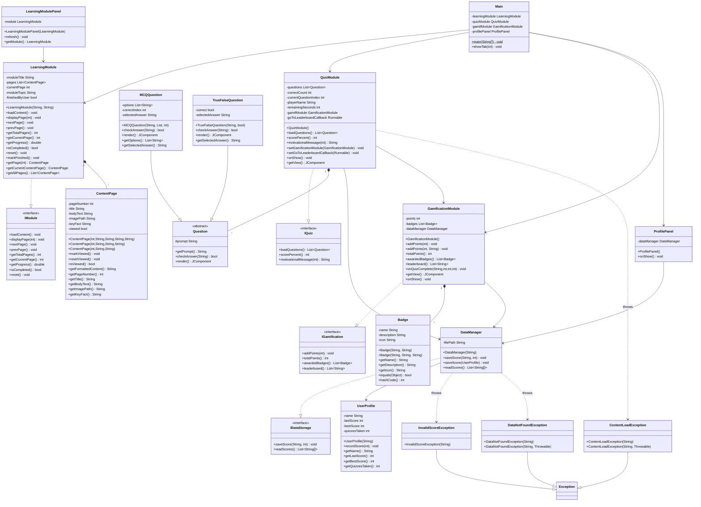

# Prompt: Render EduSDG UML Diagram as Claude Artifact

> **Instructions for Claude:**
> Wrap the Mermaid class diagram code below inside an HTML page that uses the **Mermaid.js CDN**
> so it renders as a live visual artifact in this chat window.
>
> Requirements for the HTML artifact:
> - Use Mermaid.js from CDN: `https://cdn.jsdelivr.net/npm/mermaid@10/dist/mermaid.min.js`
> - Centre the diagram on the page with a white background
> - Add a title at the top: **"EduSDG – SDG 4 Quality Education | Class Diagram"**
> - Add a colour-coded legend below the title (4 coloured chips):
>   - 🟢 Member 1 – Learning Module
>   - 🔵 Member 2 – Quiz Module
>   - 🟡 Member 3 – Gamification Module
>   - 🟠 Member 4 – Data & Exceptions
> - Set `theme: 'default'` and `classDiagram` font size to 13px
> - Do NOT modify the Mermaid diagram code — paste it exactly as given below

---

## Mermaid Class Diagram Code (paste as-is into the HTML)

---

> Output only the HTML artifact. No explanation needed.
